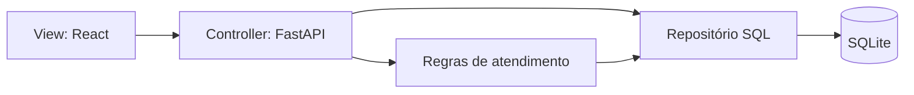

# Arquitetura do IndusTrack

[Índice da documentação](README.md)

## Visão geral

A aplicação utiliza uma organização baseada em MVC com API REST. O React compõe a View; os controllers FastAPI recebem as requisições; entidades, regras de atendimento e repositórios formam a camada de domínio e persistência.



As respostas retornam em JSON. O frontend usa essas respostas para atualizar a interface. O arquivo `views/serializers.py` define representações públicas das entidades, incluindo a exclusão do hash de senha.

## Estrutura

```text
industrack/
├── backend/
│   ├── app/
│   │   ├── controllers/       # Rotas HTTP
│   │   ├── core/              # Configuração e autenticação
│   │   ├── repositories/      # SQL parametrizado
│   │   ├── services/          # Regras de atendimento
│   │   ├── views/             # Representações JSON
│   │   ├── database.py        # Conexões e inicialização
│   │   ├── main.py            # Composição da aplicação
│   │   ├── models.py          # Entidades
│   │   ├── schemas.py         # Validação de entrada
│   │   └── seed.py            # Carga demonstrativa
│   ├── sql/                   # Estrutura e INSERTs demonstrativos
│   └── tests/                 # Testes da API e do fluxo
├── frontend/
│   └── src/
│       ├── components/        # Elementos compartilhados
│       ├── hooks/             # Carregamento de dados
│       ├── pages/             # Telas
│       ├── services/          # Cliente HTTP
│       ├── types/             # Contratos TypeScript
│       ├── App.tsx            # Sessão e rotas
│       ├── main.tsx           # Entrada do frontend
│       └── style.css          # Estilos compartilhados
└── docs/                      # Documentação
```

## Backend

| Componente | Responsabilidade |
|---|---|
| `main.py` | Configurar FastAPI, CORS, inicialização e registro dos controllers |
| `core/config.py` | Carregar o `.env` e centralizar as variáveis |
| `core/security.py` | Validar JWT, consultar o usuário ativo e verificar perfis |
| `schemas.py` | Validar dados recebidos com Pydantic |
| `controllers/` | Adaptar as operações ao contrato HTTP |
| `services/orders.py` | Coordenar transições de ordens, chamados e histórico |
| `services/support.py` | Compartilhar validações de acesso e registro de atividades |
| `repositories/sql_repository.py` | Executar SQL e aplicar o escopo de acesso nas consultas |
| `models.py` | Definir entidades e metadados SQLAlchemy |

Ordens possuem um serviço próprio porque suas ações alteram múltiplos registros. Operações mais simples de cadastros e chamados permanecem nos controllers. O projeto não exige uma classe ou camada adicional para cada operação.

SQLAlchemy gerencia conexões e transações, mas a persistência utiliza comandos SQL explícitos. As entidades retornadas pelo repositório são desacopladas da sessão: modificar seus atributos não basta para salvar; a operação deve chamar `insert` ou `save` e confirmar a transação.

## Transação de conclusão

1. Validar o perfil e a responsabilidade pelo atendimento.
2. Conferir se a ordem está em execução e validar diagnóstico e solução.
3. Atualizar a ordem e sua data de conclusão.
4. Marcar o chamado como resolvido.
5. Registrar a atividade no histórico.
6. Confirmar a transação. Se ocorrer uma exceção, desfazer as alterações.

## Frontend

As páginas são carregadas sob demanda. O cliente HTTP centraliza token, tempo limite e tratamento de sessão expirada. O hook `useData` cancela requisições anteriores ao trocar a consulta, evitando que uma resposta antiga substitua os dados atuais.

Formulários, badges e estados de carregamento, erro e ausência de dados são compartilhados. O login usa React Hook Form e Zod; os demais formulários combinam validação HTML com a validação Pydantic no servidor. Os contratos recebidos da API são descritos em `types/domain.ts`.

## Convenções para novos recursos

- Definir entradas Pydantic e contratos TypeScript antes de integrar a tela.
- Manter SQL nos repositórios e vincular valores por parâmetros.
- Verificar autorização no backend, mesmo quando a ação estiver oculta na interface.
- Agrupar alterações relacionadas em uma transação.
- Reutilizar componentes e apresentar estados de carregamento, falha e lista vazia.
- Criar testes para regras e falhas relevantes usando banco separado.
- Preparar migrações explícitas ao modificar colunas existentes.

Consulte [instalação](INSTALACAO.md) para executar as verificações e [escopo](ESCOPO.md) para as funcionalidades ainda planejadas.

## Evolução 1.0.2

`migrations` introduz Alembic e a adoção incremental do esquema legado. A conexão seleciona SQLite ou PostgreSQL com psycopg por `DATABASE_URL`. Produção exige SSL e não cria tabelas no startup. Os UUIDs são gerados no servidor e persistidos em equipamentos.

`services/equipment.py` resolve identificadores e constrói a URL pública de QR. `controllers/operations.py` contém preventivas, notificações e CSV. `services/notifications.py` grava eventos na transação do atendimento. As telas novas usam o mesmo cliente autenticado e não simulam registros.

Esta evolução ainda precisa de homologação PostgreSQL e de interface; o relatório `RELEASE_1_0_2.md` prevalece sobre a descrição do escopo anterior.
