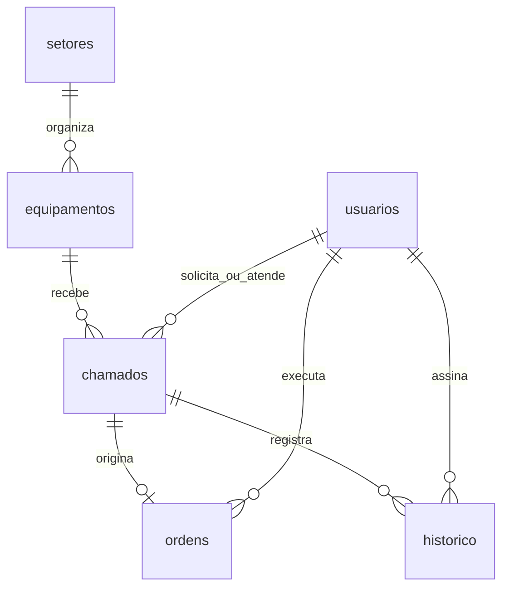

# Banco de dados

[Índice da documentação](README.md)

## Persistência

O projeto utiliza exclusivamente SQLite. SQLAlchemy gerencia as conexões e transações e define os metadados das entidades. O repositório executa SQL explícito com parâmetros nomeados.

| Arquivo | Responsabilidade |
|---|---|
| `backend/sql/schema.sql` | Tabelas, chaves estrangeiras e índices |
| `backend/sql/seed_demo.sql` | INSERTs dos dados fictícios |
| `backend/app/models.py` | Representação das entidades |
| `backend/app/repositories/sql_repository.py` | Consultas, inserções e atualizações |
| `backend/app/database.py` | Conexão, integridade referencial e inicialização |
| `backend/app/seed.py` | Execução controlada da carga demonstrativa |

Os caminhos desta página partem da pasta `industrack`.

## Entidades

| Tabela | Dados e relacionamentos |
|---|---|
| `usuarios` | Nome, e-mail único, hash da senha, perfil e situação ativa |
| `setores` | Nome único do setor |
| `equipamentos` | Código único, identificação, localização, criticidade, status e setor |
| `chamados` | Descrição da ocorrência, equipamento, solicitante, técnico, prioridade, status e datas |
| `ordens` | Chamado de origem único, técnico, diagnóstico, solução, status e datas |
| `historico` | Evento ou comentário, chamado, autor e data |
| `seed_versions` | Versão e data da carga demonstrativa aplicada |



Comentários e eventos compartilham a tabela `historico`, diferenciados pelo campo `tipo`. Não existe uma tabela independente de comentários nesta implementação.

## Integridade e consultas

- `PRAGMA foreign_keys=ON` é aplicado a cada conexão.
- A relação única entre ordem e chamado impede ordens duplicadas.
- Há índices para solicitante, técnico, equipamento, status e histórico do chamado.
- Filtros, paginação e agregações são executados no SQLite.
- Valores recebidos da API são vinculados a parâmetros, sem concatenação de entrada do usuário no SQL.
- Falhas durante o atendimento desfazem a transação, preservando a consistência entre ordem, chamado e histórico.

Exemplo do padrão de consulta:

```sql
SELECT * FROM usuarios WHERE email = :email;
```

## Dados mockados

Na pasta `backend`, com o ambiente virtual ativo:

```bash
python -m app.seed
```

A carga contém 8 usuários, 3 setores, 8 equipamentos, 15 chamados, 8 ordens, comentários e histórico. Os chamados apresentam diferentes estados; algumas ordens estão pendentes, outras em execução e outras concluídas.

As datas são calculadas em relação ao momento da carga. Senhas são transformadas em hashes Argon2 antes da inserção. O frontend obtém os registros pela API, sem substituir o banco por dados fixos nos componentes.

O seed é atômico e idempotente: registra sua versão em `seed_versions` e não duplica a carga. Se houver usuários em um banco sem essa marcação, ele preserva os dados e não executa os INSERTs.

Para criar outra demonstração sem alterar o banco atual, execute ambos os comandos com a mesma URL:

```bash
DATABASE_URL=sqlite:///./industrack-demo.db python -m app.seed
DATABASE_URL=sqlite:///./industrack-demo.db uvicorn app.main:app --reload --host 127.0.0.1 --port 8000
```

O arquivo `seed_demo.sql` depende dos parâmetros de senha e datas fornecidos pelo executor Python. Use o comando de seed, em vez de executar esse arquivo isoladamente.

## Evolução do esquema

A inicialização cria tabelas e índices ausentes com `IF NOT EXISTS`. Ela não altera colunas de tabelas existentes. Mudanças estruturais futuras precisam de migrações explícitas; ainda não há um sistema automatizado de migrações.
